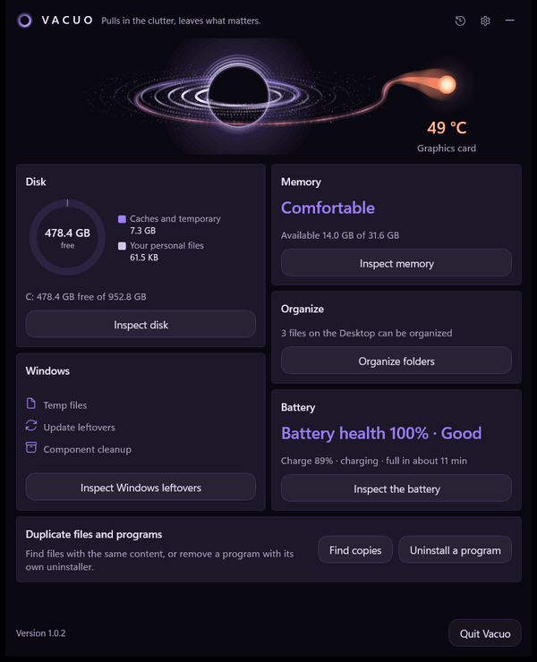
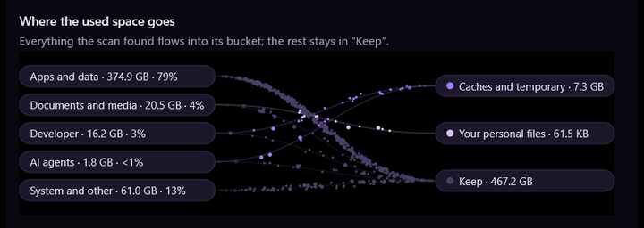
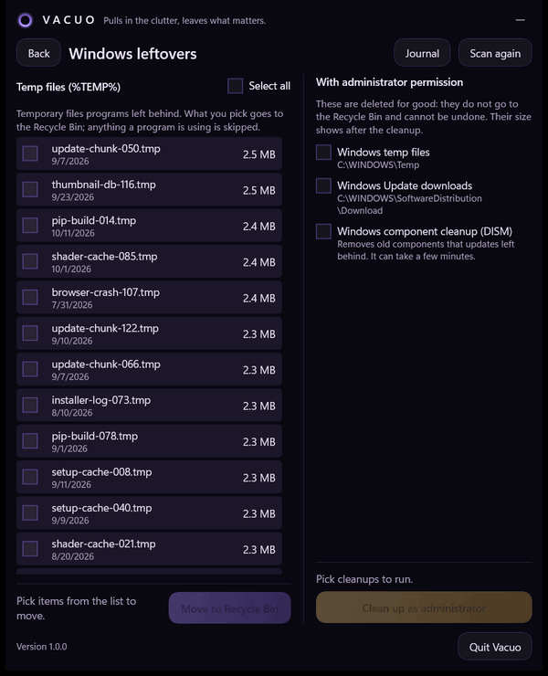
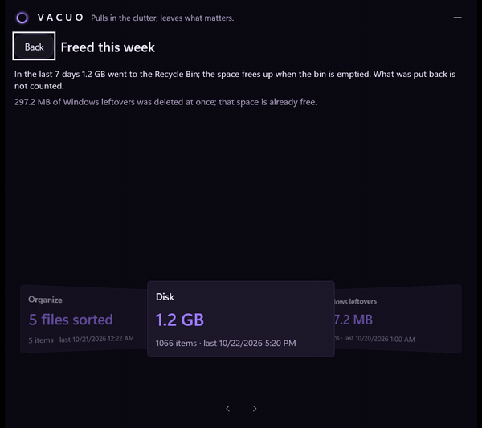
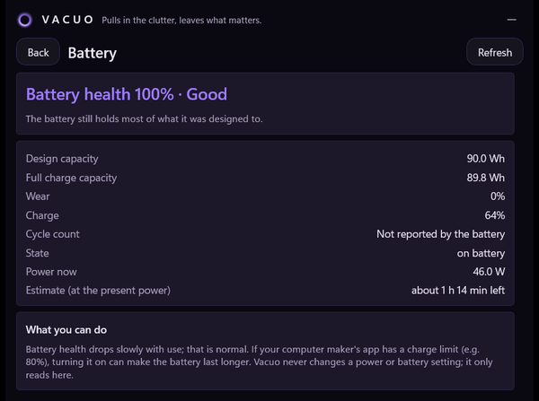

  <a href="./README.tr.md">Türkçe</a> · <b>English</b>

<h1 align="center">VACUO</h1>

<i>Pulls in the clutter, leaves what matters.</i>

  
  
  
   
  
  
  

  

Vacuo is a maintenance tool for Windows 11 that lives in the system tray. Click its icon and one panel shows your disk, the leftovers Windows keeps, your memory and your messiest folders, with a clear answer to *what can go, what it will cost, and how to get it back*.

It is built around one rule: **measure honestly, change nothing without you.** Caches come with what it costs to download them again. There is no "RAM booster" and no force-closing. Everything you remove goes to the Recycle Bin and can be put back from the Journal; the one exception, Windows' own administrator folders, says so before it runs.

## A look inside

**Where the space goes.** The Disk screen splits your used space into apps, documents, developer tools, AI agents and the system, then lets every file the scan found flow into its bucket: caches and temporary files, your own large files, or *Keep*. Each cache shows how it comes back (downloaded again, reinstalled with a command) before you pick it.

  

**Windows leftovers.** Your temp folder is listed item by item; pick some or press *Select all*, and a bar follows the move to the Recycle Bin. Windows Temp, update downloads and the DISM component cleanup sit on the right: they need administrator approval, are deleted for good, and Vacuo tells you that before you start.

  

**Freed this week.** The history icon in the header turns the last seven days into a slowly turning carousel: how much each part of Vacuo freed, how many items, and when. With animations off in Windows, it is a plain list.

  

**Memory** shows pressure instead of a "% used" number, lists apps that have been idle for hours, closes the ones you pick with a normal close request (so an app with unsaved work can still ask you), and measures the real difference afterwards.

**Organize** sorts Desktop, Downloads or any folder by rules, shows the result as files flowing into their folders before anything moves, and undoes the whole batch with one click.

**Duplicate files** finds files with the same content (size, then a quick fingerprint, then a full SHA-256) in the folders you choose; nothing is pre-selected and you decide which copy stays. **Uninstall** starts each program's own uninstaller and then suggests the folders it left behind.

**Battery** reads health, capacity and wear straight from the battery driver on laptops; on desktops the card simply does not appear.

  

**Automatic maintenance** is off until you turn it on. Then, at most once a day while the computer is idle and plugged in, it moves only what can be undone and tells you with a small card in the corner. If memory gets tight, the tray can let you know, and it never closes anything by itself.

## Getting started

**1. Download** `Vacuo-<version>-setup.exe` from [Releases](https://github.com/AlicanKaya192/Vacuo/releases/latest). Windows 11, 64-bit.

**2. Run it.** Vacuo installs for your own user under `%LOCALAPPDATA%\Programs\Vacuo` and asks for no administrator rights. It adds a Start menu shortcut and, unless you untick it, starts with Windows. When the setup finishes, the panel opens so you can see where Vacuo lives.

**3. Windows may warn you the first time.** "Windows protected your PC" is SmartScreen: the setup is not code-signed, so Windows does not know the publisher yet. Click **More info**, then **Run anyway**. If Smart App Control is on, it may block the setup altogether.

### Where your data lives

Your settings, the Journal, the results of administrator clean-ups and the update state are kept in `%LOCALAPPDATA%\Vacuo\`, apart from the program. Updating or reinstalling never touches them; uninstalling leaves them too, so delete that folder as well if you want everything gone. Scan results, the duplicate search and the program list live in memory only.

### Updating

When the panel opens (at most every six hours) or when you press **Check now** in Settings, Vacuo reads this repository's release list. If there is a newer version, the header says so. Press **Update** and Vacuo downloads the setup, checks its size, its signature bytes and its SHA-256, closes, and the new version installs silently and opens again. You can keep using Windows while it downloads; the tray icon shows the percentage and the time left. From the next release on, updates download only the files that changed.

Turn **Check for updates** off in Settings and Vacuo never goes online. The tray icon never does.

### Uninstalling

**Settings › Apps › Installed apps › Vacuo › Uninstall** removes the program and its startup entry.

## Safe by design

- Nothing happens without your choice. Nothing is pre-selected, and Automatic maintenance is off by default.
- Removed files go to the Recycle Bin, and Vacuo never empties it. The only things deleted for good are Windows Temp, update downloads and the DISM cleanup, after an administrator prompt that says so; they are logged in the Journal.
- Vacuo itself never runs as administrator. A separate, short-lived helper asks for it only for that clean-up, and it is told which fixed item to clean, never a path.
- No registry cleaning, no services, drivers, power or system settings.
- No account, no telemetry, no ads. The update check is the only network connection.

## Built with

C# on .NET 10, WinUI 3 (Windows App SDK), Windows.UI.Composition and Win2D for the animations, Inno Setup for the installer, and GitHub Actions for the releases.

## License

[MIT](LICENSE) © 2026 Alican Kaya
